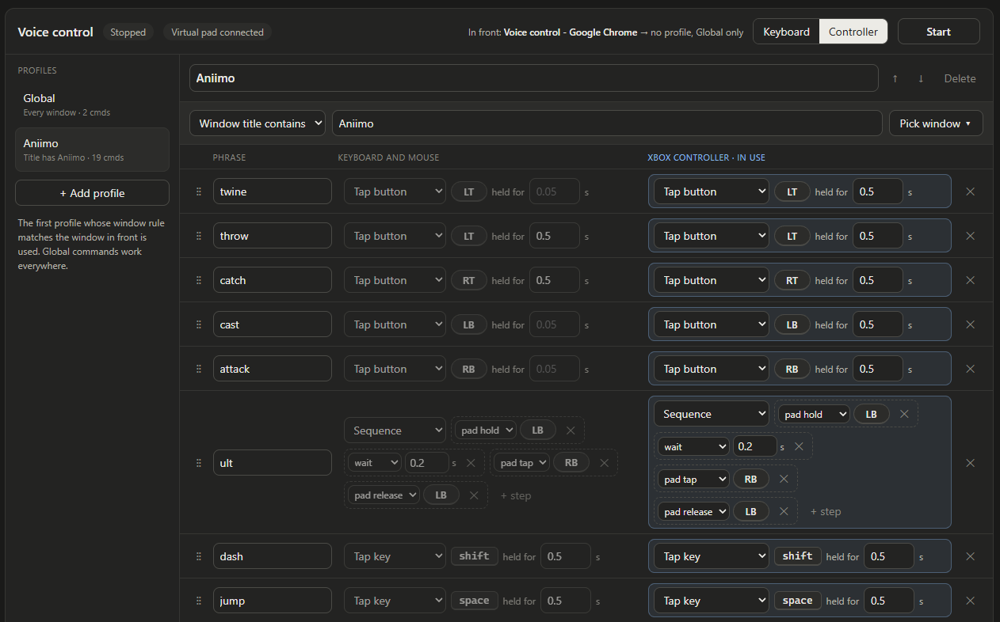

# Voice Control for Games



Say a short command and the game in focus gets the matching keyboard, mouse or Xbox controller input. It adds to your normal controls; it doesn't replace them.

> Say **"jump"** → the program taps **Space** (or presses **A** on a virtual controller).

- **Offline.** Speech recognition runs locally with [Vosk](https://alphacephei.com/vosk/); nothing is sent to the cloud.
- **Low latency.** Recognition is restricted to your configured phrases, and commands fire on partial results, while you're still speaking.
- **Works in games.** Keys are sent as scan codes (`pydirectinput`), which DirectInput/Raw Input games accept. Controller input goes through a virtual Xbox 360 pad.
- **Per-game profiles.** Commands can be tied to a window, so "attack" does different things in different games.
- **Web editor.** Start/stop listening, edit mappings and see what was heard at `http://127.0.0.1:8765`.

## Requirements

- Windows 10/11 x64
- Python 3.10+ (the code uses `list[str]` / `X | None` type syntax)
- A microphone (a headset helps keep game audio out of the mic)

## Setup

```powershell
pip install vosk sounddevice pyyaml pydirectinput
pip install vgamepad        # optional: controller mode (also installs the ViGEmBus driver)
```

Download `vosk-model-small-en-us-0.15` from <https://alphacephei.com/vosk/models> and unzip it next to `voice_control.py` so that `vosk-model-small-en-us-0.15\am` exists. Watch for a doubled folder (`vosk-model-small-en-us-0.15\vosk-model-small-en-us-0.15\am`). If you see one, move the inner contents up a level. The program exits with a message if it can't find the model.

## Run

```powershell
python voice_control.py [commands.yaml] [--port 8765] [--no-browser] [--start]
```

| Option          | Meaning                                                                 |
| --------------- | ----------------------------------------------------------------------- |
| `commands.yaml` | Config file (default: the one next to the script)                       |
| `--port`        | Port for the editor (default `8765`, bound to `127.0.0.1` only)         |
| `--no-browser`  | Don't open the editor on launch                                         |
| `--start`       | Start listening immediately instead of waiting for the **Start** button |

Open the editor, press **Start**, then switch to your game. **Ctrl+C** in the terminal quits and releases every held key.

If the game runs as Administrator, run the terminal as Administrator too. Otherwise Windows silently drops the injected input.

## Configuring commands

Mappings live in [commands.yaml](commands.yaml) and can be edited in the web UI (the UI rewrites the file on **Save**) or by hand. The file's header comment lists every action.

```yaml
input_mode: keyboard # keyboard | controller
global: # work in every window
  voice off: { listen: false }
  voice on: { listen: true }
profiles: # work only while a matching window is in front
  - name: My game
    match: { title_contains: My Game }
    commands:
      jump: { tap: space }
      sprint: { hold: shift }
      stop: { release_all: true }
      heal:
        sequence:
          - { tap: "4" }
          - { wait: 0.05 }
          - { click: left }
      dodge: # a different input per mode
        keyboard: { tap: ctrl }
        controller: { pad_tap: b }
```

### Profiles

A profile's `match` is one of `title_contains`, `process` (e.g. `game.exe`) or `title_regex`. The first matching profile wins, and on a phrase clash it beats `global`. When the foreground window changes, all held inputs are released and the recognizer switches to the new vocabulary.

### Input modes

`input_mode` picks which input each command sends. A command is either a single action (used in both modes) or `{keyboard: ..., controller: ...}`. If you leave one mode out, the command does nothing in that mode. Toggle the mode in the UI.

### Actions

| Action                     | Example                                                  | Behavior                                                                    |
| -------------------------- | -------------------------------------------------------- | --------------------------------------------------------------------------- |
| `tap`                      | `{tap: space}`, `{tap: s, duration: 0.6}`                | Key down, wait `duration` (default 0.03 s), key up                          |
| `hold` / `release`         | `{hold: shift}`                                          | Key down and keep it held / key up                                          |
| `release_all`              | `{release_all: true}`                                    | Release every held key and button                                           |
| `click`                    | `{click: left}`                                          | Mouse click (`left`, `right`, `middle`)                                     |
| `sequence`                 | `{sequence: [{tap: space}, {wait: 0.15}, {tap: space}]}` | Run steps in order; `{wait: seconds}` sleeps                                |
| `listen`                   | `{listen: false}`                                        | Pause or resume voice control (always honored; pausing releases everything) |
| `pad_tap`                  | `{pad_tap: a, duration: 0.5}`                            | Press and release a controller button (default 0.05 s)                      |
| `pad_hold` / `pad_release` | `{pad_hold: lb}`                                         | Hold / release a controller button                                          |
| `stick`                    | `{stick: left, dir: up, amount: 0.8, duration: 1}`       | Push a stick. Without `duration` it stays until `dir: center`               |

- Keys follow [pydirectinput](https://github.com/learncodebygaming/pydirectinput) names: `a`–`z`, `0`–`9`, `space`, `shift`, `ctrl`, `alt`, `tab`, `enter`, `esc`, `f1`–`f12`, arrows, …
- Pad buttons: `a b x y lb rb lt rt back start guide ls rs dpad_up dpad_down dpad_left dpad_right`.
- Stick directions: `up down left right up_left up_right down_left down_right center`.
- Phrases may only contain letters, spaces and apostrophes. The editor reports validation errors instead of saving a bad config.

Other settings: `fire_on_partial` (fire mid-utterance, default `true`), `block_ms` (audio block size, default `50`) and `model` (model folder, relative to the config).

## Controller mode

Controller actions need `vgamepad` and the ViGEmBus driver. The virtual pad is plugged in when you press **Start** (if any command uses it) and stays connected for the session, since games dislike controllers that come and go. Without the driver, keyboard commands still work and the UI shows the error.

## How it works

```
mic → sounddevice → Vosk (grammar = your phrases + [unk]) → Matcher → worker thread → pydirectinput / vgamepad
```

- **Restricted grammar.** The recognizer only knows the active phrases plus `[unk]`, which soaks up game audio and chatter instead of forcing a false match.
- **Longest match, fire early.** `Matcher` greedily matches words to phrases, so "sprint forward stop" works in one breath. A phrase that is a prefix of a longer one ("quick" vs "quick save") is held back until the speaker finishes.
- **Worker thread.** Actions run on a queue, so sequences with waits never block audio. `stop`, window changes and pausing cancel running sequences and release everything.

The file layout:

| File                                           | Purpose                                                                                |
| ---------------------------------------------- | -------------------------------------------------------------------------------------- |
| [voice_control.py](voice_control.py)           | Everything: audio loop, matcher, executor, window watcher, config, local HTTP server   |
| [ui.html](ui.html)                             | The single-page editor served by the script                                            |
| [commands.yaml](commands.yaml)                 | Your mappings. The sample profile is for a game called _Aniimo_                        |
| [VOICE_CONTROL_SPEC.md](VOICE_CONTROL_SPEC.md) | The original design handoff. The code has grown past it (profiles, controller, web UI) |

## Tips and gotchas

- **Anti-cheat.** Competitive online games (EAC, BattlEye, Vanguard) may flag or block injected input. Stick to single-player or offline games.
- **Phrase choice.** Short, similar-sounding words collide ("jump"/"dump", "left"/"lift"). Prefer distinct one- or two-word phrases.
- **Missed taps.** If a game misses quick taps, raise `duration`.
- **Security.** The editor only accepts requests whose `Host`/`Origin` is `127.0.0.1` or `localhost` on its port, so other web pages can't change your mappings or toggle the mic.
- **Old config format.** A flat `commands:` file is converted to global/profile form on first save, and the original is kept as `commands.yaml.bak`.
